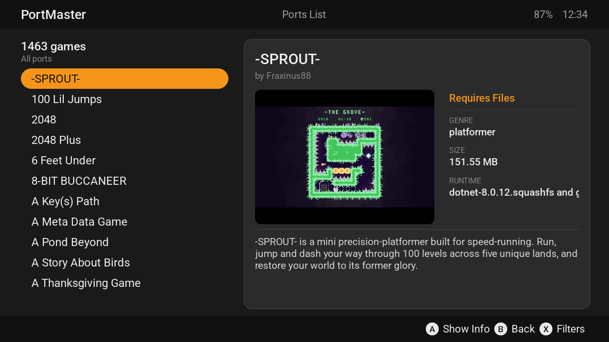
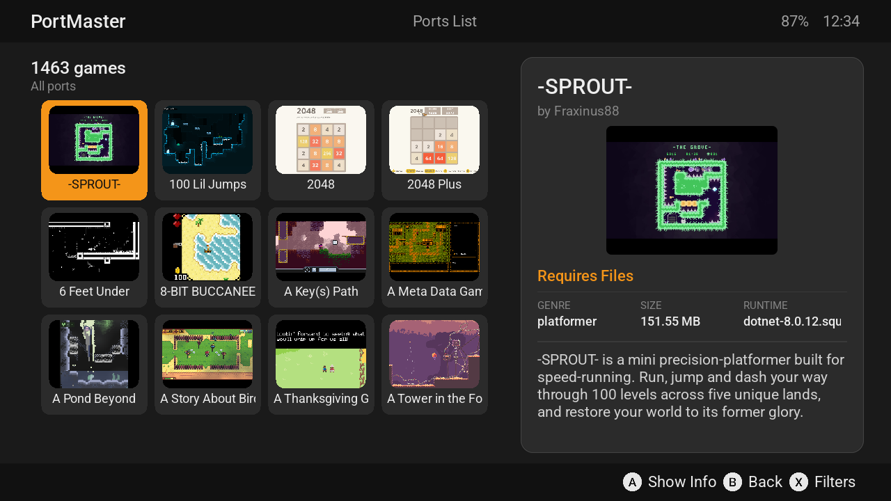
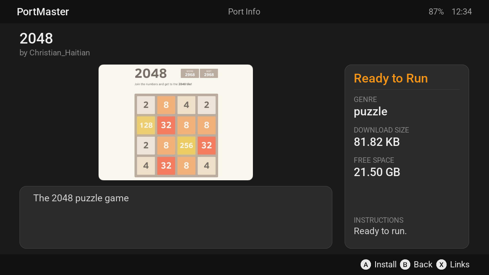
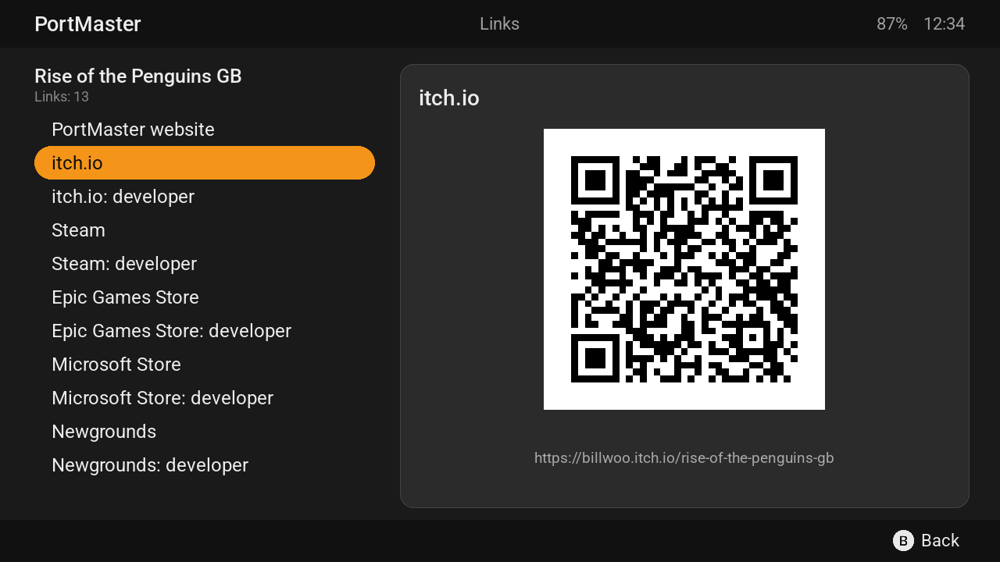
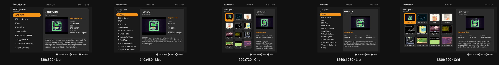
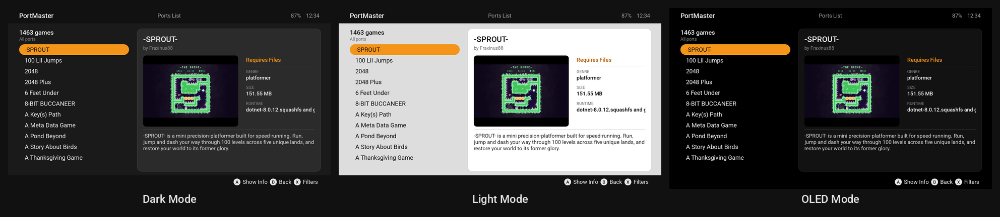
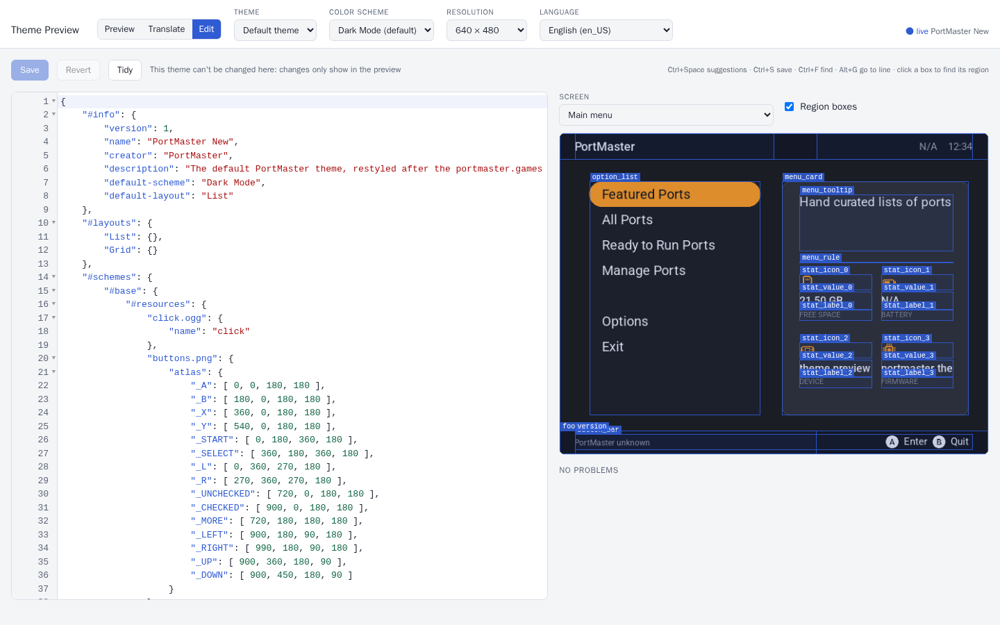
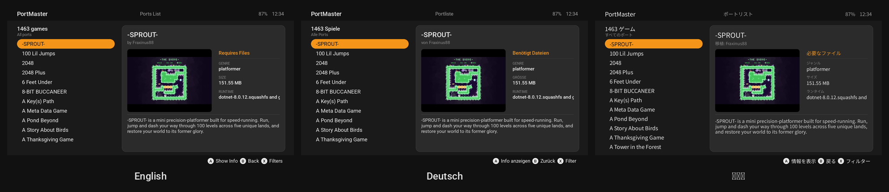

# PortMaster

**PortMaster downloads, installs and updates over 1,400 PC games ported to Linux handhelds**: Anbernic, Retroid, TrimUI, Miyoo, Powkiddy and more, on AmberELEC, dArkOS, ROCKNIX, muOS, Knulli and the other systems they run. Pick a game, press A, and it's in your ports list, with everything it needs to run.



This repository is PortMaster itself: the app on your handheld (an SDL2 interface written in Python), its command-line tool, and the scripts every port uses to launch. The ports are in [PortMaster-New](https://github.com/PortsMaster/PortMaster-New), the themes in [PortMaster-Themes](https://github.com/PortsMaster/PortMaster-Themes), and the website is [portmaster.games](https://portmaster.games).

**[Install PortMaster](https://portmaster.games/installation/installing-portmaster/)** · [Supported handhelds](https://portmaster.games/installation/supported-handhelds/) · [Browse the ports](https://portmaster.games/games/) · [Discord](https://discord.gg/SbVcUM4qFp)

## What it does

- **Over 1,400 ports**, with screenshots, descriptions and genres. Browse them all, the **Ready to Run** ones (nothing else to copy over), or the **Featured** lists, and filter and sort them however you like.
- **A list or a grid**, in themes that offer both, like the default: **Options › Select Layout** shows the ports as a list or as a grid of their screenshots.
- **Everything a port needs**: the runtimes it uses (Mono, Godot, Love2D …) download with it, and every download is checked before it's installed.
- **Updates**: ports that have a newer version say so, and PortMaster updates itself.
- **Links to the game**: on a port's details, X shows its store pages (Steam, itch.io, GOG …) and its page on portmaster.games as QR codes, to open on your phone.
- **Any screen**: from 480x320 to 1920x1152, wide, 4:3 and square, the screens fit.
- **15 languages**, switched in Options without a restart.
- **Themes**, and a theme editor built in: see below.









## Themes

PortMaster's look is a theme, and you can pick another one, or make your own.

- **PortMaster New**, the default, matches portmaster.games: three color schemes (Dark, Light and OLED), and a list or a grid layout (a theme can offer layouts to choose from; this one does).
- **More themes** are a download away in **Options › Select Theme**, from [PortMaster-Themes](https://github.com/PortsMaster/PortMaster-Themes): PortMaster Classic, FF VII, Zelda, Doom, Stardew, Fallout, Hi Viz, grid themes and more. Themes, color schemes, layouts and languages all change straight away.
- **Make your own**: **Options › Theme Editor** starts an editor on your handheld. Open the address it shows in a browser on the same Wi-Fi, and edit a theme with every PortMaster screen previewed as you type, at any screen size, in any language. It works from a PortMaster-GUI checkout on a computer too.





To make a theme, start with **[Creating a theme](https://portmaster.games/contribute/gui/creating-a-theme/)**: it builds one step by step, from an empty folder to one in PortMaster's theme list. Everything a theme can do is in the **[theme reference](THEME.md)** ([on the website](https://portmaster.games/contribute/gui/theme-engine/)).

## Languages

PortMaster speaks English, Deutsch, Español, Français, Italiano, Nederlands, Polski, Português (Brasil), Română, Русский, Svenska, Українська, 日本語, 한국어 and 简体中文.



**Translating:** the theme server has a translation editor. Pick **Translate**, choose a language, and it lists every string with the screens it's on, which redraw in that language as you type, so you can see if a translation fits. It saves into `PortMaster/pylibs/locales/`: send them as a pull request, or ask on Discord.

## Supported systems

ArkOS, dArkOS, AmberELEC, EmuELEC, ROCKNIX (and JELOS, UnofficialOS), Batocera, REG-Linux, Knulli, muOS, Miyoo (Onion & co), TrimUI (and NextUI), spruce, nuubOS, RetroDECK, and others. [Supported handhelds](https://portmaster.games/installation/supported-handhelds/) lists the devices.

## For porters and developers

- **Porting a game?** [How to contribute](https://portmaster.games/contribute/) covers what can be ported, build environments, launch scripts and packaging. Ports are submitted to [PortMaster-New](https://github.com/PortsMaster/PortMaster-New).
- **Testing a port zip** on a device: `./harbourmaster install ./MyPort.zip`, or a URL (`<url>/MyPort.zip.md5` checks it against its md5).
- **Working on PortMaster:** there's no build step. From a checkout:

  ```bash
  python3 -m venv .venv && .venv/bin/pip install -r requirements-dev.txt
  .venv/bin/pytest                    # the tests
  python3 PortMaster/pugwash          # the GUI, in a window
  python3 PortMaster/harbourmaster help
  ```

  `./do_release.sh test` builds a test `PortMaster.zip`. PortMaster has to keep running on Python 3.7, which some systems still ship.

## Feedback

Bugs, ideas and questions: the [PortMaster Discord](https://discord.gg/SbVcUM4qFp), or an issue here.

## Thanks

To everyone in the PortMaster crew, the porters who make the ports, the translators, the themers, and everyone who's tested a build on their handheld: thank you. A special thanks to:

- [christianhaitian](https://github.com/christianhaitian)
- [cebion](https://github.com/cebion)
- [christopher-roelofs](https://github.com/christopher-roelofs)
- [tekkenfede](https://github.com/tekkenfede)
- and so many more! :heart:

## Libraries

PortMaster carries these with it:

- [ansimarkup][ansimarkup]
- [certifi][certifi]
- [charset-normalizer][charset_normalizer]
- [colorama][colorama]
- [fastjsonschema][fastjsonschema]
- [idna][idna]
- [loguru][loguru]
- [port_gui][port_gui] (as `pugwash.sdl`)
- [pypng][pypng]
- [qrcode][qrcode]
- [PySDL2][pysdl2]
- [requests][requests]
- [typing-extensions][typing_extensions]
- [urllib3][urllib3]

[ansimarkup]: https://pypi.org/project/ansimarkup/
[certifi]: https://pypi.org/project/certifi/
[charset_normalizer]: https://pypi.org/project/charset-normalizer/
[colorama]: https://pypi.org/project/colorama/
[fastjsonschema]: https://pypi.org/project/fastjsonschema/
[idna]: https://pypi.org/project/idna/
[loguru]: https://pypi.org/project/loguru/
[port_gui]: https://github.com/mcpalmer1980/port_gui
[pypng]: https://pypi.org/project/pypng/
[qrcode]: https://pypi.org/project/qrcode/
[pysdl2]: https://pypi.org/project/PySDL2/
[requests]: https://pypi.org/project/requests/
[typing_extensions]: https://pypi.org/project/typing-extensions/
[urllib3]: https://pypi.org/project/urllib3/
